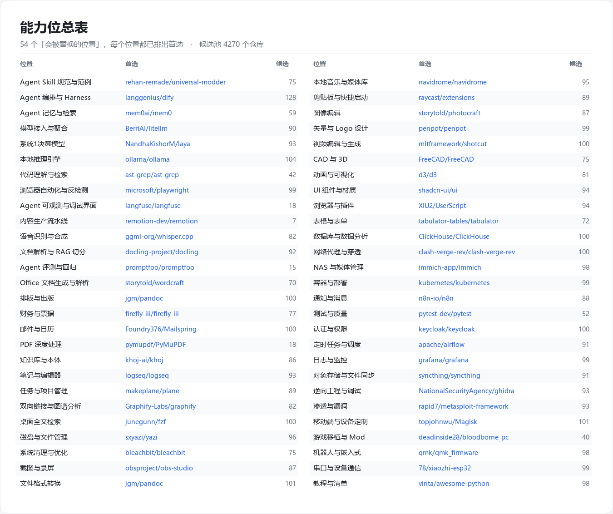
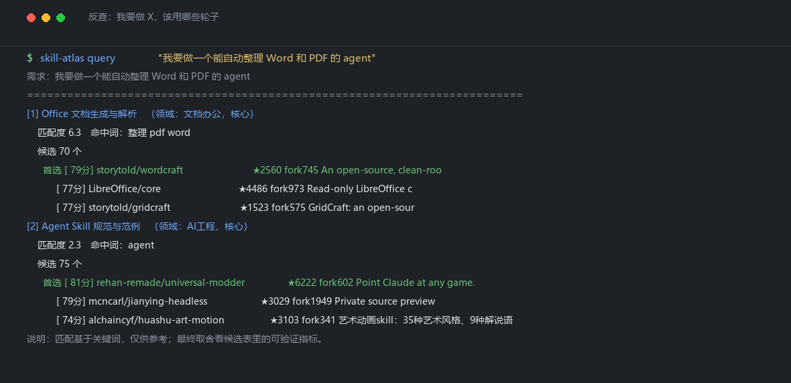
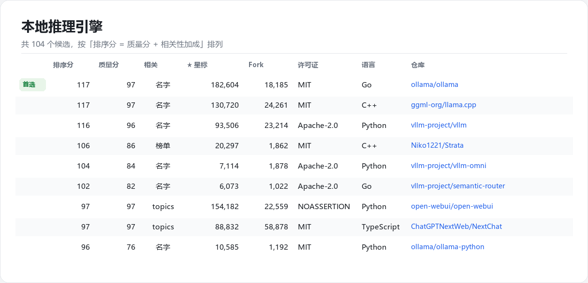

# skill-atlas

把 GitHub 上的开源项目，整理成一份**能查、能核对、会更新**的清单。

你问它：「我要做一个能自动整理 Word 和 PDF 的 agent」，它告诉你这个需求涉及哪几个位置、每个位置有哪些现成轮子、以及每个轮子能不能信——星标、fork、许可证、多久没更新过，全都是你可以点开核对的数字。



上面这张就是它产出的东西：**54 个位置，每个位置都已经挑出首选**，右边那一列数字是该位置有多少个候选。

[English README](README.en.md)

---

## 一个具体例子



```
$ skill-atlas query "我要做一个能自动整理 Word 和 PDF 的 agent"

[1] Office 文档生成与解析        命中词：整理 pdf word
      首选 [79分] storytold/wordcraft    ★2560  fork745
           [77分] LibreOffice/core       ★4486  fork973
           [77分] storytold/gridcraft    ★1523  fork575

[2] Agent Skill 规范与范例       命中词：agent
      首选 [81分] rehan-remade/universal-modder   ★6203  fork597
```

它不只是丢给你一个名字，而是：

- 先判断你的需求对应**哪几个「位置」**（这里命中了两个）
- 每个位置给出**一批候选**，按可核对的指标排序
- 标出每个候选**为什么被认为相关**（关键词命中了仓库名？还是只出现在描述里？）

---

## 它想解决的是什么问题

直接问 AI「这个功能该用什么库」，你会拿到两三个名字。那两三个名字来自模型的记忆，于是有三个麻烦：

**会过时。** 模型的知识有截止日期。上个月刚出现的项目它没见过，可能反而推荐一个已经没人维护的老库。

**没法核对。** 它说「这个很流行」，但它不会告诉你那个仓库其实是刷星刷出来的空壳，里面只有一份 README。

**每次从零开始。** 你上次已经对比过、否决过的东西，下次开新会话还得重来一遍。

这个项目做的事很窄：把「现在有哪些轮子」从记忆里拿出来，变成一份可以查、可以核对、可以积累的清单。它不管「这个轮子适不适合你的场景」——那件事仍然该问 AI。

---

## 它是怎么挑项目的

这一部分是这个项目里真正花了功夫的地方，也是它和「随便搜一下」的区别。

### 发现一：GitHub 的「新建热榜」上一大半是垃圾

最开始我按最直觉的做法抓数据：最近 24 小时创建的仓库、按星标排序、取前 100。结果榜首是这样的：

```
KindStatesman/KMS-Pico
  星标 614    fork 0    watcher 0    issue 0
  体积 2KB    语言 无     许可证 无
  仓库里只有 1 个文件：README.md
  创建于 2026-10-09 13:53:07，最后一次提交 13:53:14 —— 相隔 7 秒
```

614 个星标，0 个 fork，0 个 watcher，0 个 issue，**仓库里没有一行代码**。它的 README 用 AI 生成的话术描述「优化你的专业桌面环境」，tags 里直接写着 `ms-project-crack`、`photoshop-file-not-found`。四个这样的仓库，来自四个不同账号，**账号全是同一天注册的**，每个只有 2 个仓库、0 个粉丝。

实测三个时间窗口的垃圾比例：

| 榜单 | 100 条里有多少是这种垃圾 |
|---|---:|
| 最近 24 小时 | **91 条** |
| 最近 7 天 | 23 条 |
| 最近 30 天 | 1 条 |

原因不难理解：24 小时的窗口里，真实项目根本来不及积累星标（一个正常发布的项目首日能拿到 100 多星就算不错），而刷 300 个星的成本极低，直接霸榜。到 30 天窗口，真项目有几万星，刷子那几百星就挤不进来了。

### 发现二：怎么判断一个仓库是不是空壳

「描述看起来像 AI 写的」不算证据。真正的证据是**仓库体积**：只有一个 README 的仓库大约 2–4 KB，而真有代码的仓库极少低于 1 MB。

我把 300 条榜单记录的体积画出来，分布是干净的双峰：

```
   ≤ 8 KB  : 115 条   ████████████████████████████████
   9–50 KB :   3 条
 51–200 KB :   8 条   ██
201 KB–1 MB : 16 条   ████
    ≥ 1 MB  : 158 条   ███████████████████████████████████████████
```

两个峰之间几乎是空的，所以这个阈值不敏感——取 9 KB 还是 500 KB，结论都一样。

然后我做了一件我觉得最有价值的事：**用两套完全独立的判据互相验证**。

| | 条数 |
|---|---:|
| 两套判据都判为垃圾 | 108 |
| **只有「描述话术」判为垃圾（可能的误伤）** | **0** |
| 只有「体积/社区行为」判为垃圾（话术漏判） | 7 |
| 两套都放行 | 185 |

第一行是结果，第二行才是关键：**话术判据的误伤数是 0**。它标出来的每一条，体积判据都独立确认了。单一判据无论调得多好，都没法报告自己的误判率——只有拿两套不同性质的判据对撞才能得到这个数。

### 发现三：只按星标排序，会把不相关的东西排到最前面

补全成熟项目时，我按能力位写检索式去全量搜库。查「Agent 编排框架」时，第一名是 `microsoft/markitdown`——一个把文件转成 Markdown 的工具，18.9 万星。它只是在 tags 里蹭到了 `langchain` 之类的词。

我也试过 GitHub 自己的「最佳匹配」排序，更糟：它把一个 471 星的小项目排在了 `langchain` 前面。

最后我自己算相关性，依据是**关键词命中的位置**：

| 命中位置 | 含义 |
|---|---|
| 仓库名里 | 这个项目**就是**干这个的（`langchain-ai/langchain`） |
| tags 里 | 它兼做这个 |
| 只在描述里提到 | 顺带提了一句 |

这个判断依据很强，但也需要配一个例外：**只在描述里被提到的候选，即使指标更强也拿不到首位**。实测中一个 30 万星的仓库因为只在描述里写「比 ollama 更快」，被排在 18 万星的 `ollama` 后面。这是刻意的取舍，有对应的测试钉住。

### 发现四：分数必须能区分「3 万星」和「18 万星」

第一版打分公式我把星标和 fork 的对数分母设得太小，导致 3 万星和 18 万星都拿满分。后果是：

- `bas3line/ascii`（697 星 / 40 fork）得 **86 分**
- `d3/d3`（113,725 星 / 22,639 fork）得 **84 分**

一个 697 星的项目压过了 d3。分母放大之后就正常了。

现在的公式是：星标 30 + fork 25 + 许可证 10 + 代码量 10 + issue 活跃 10 + 近期活跃 15，全部是可核对的数字。详细说明和踩坑记录都在 [DESIGN.md](DESIGN.md)。



上面是「本地推理引擎」这个位置的实际候选表。注意「相关」那一列——`ollama/ollama` 是**名字命中**（关键词就在仓库名里），`open-webui` 是 **topics 命中**（它只是支持 ollama）。两者质量分都是 97，但名字命中的排在前面。

---

## 怎么用

### 先看看它长什么样（不需要网络，不需要任何账号）

```bash
git clone https://github.com/haozhouliuliuliu/skill-atlas
cd skill-atlas

python examples/demo.py                      # 跑完整条流水线，打印上面那些判断过程
python -m unittest discover -s tests -t .    # 157 个测试
```

`examples/demo.py` 会渲染一个真的库到 `examples/out/`，可以直接用 Obsidian 打开看。

### 完全离线地试一次命令行

```bash
python examples/prepare_data.py --out data --force
PYTHONPATH=src python -m skill_atlas.cli build --data data --vault vault
PYTHONPATH=src python -m skill_atlas.cli query "我要加日志监控" --data data
```

### 真的去抓 GitHub

这是一个 `src/` 布局的包，命令行需要能 import 到它——二选一：

```bash
pip install -e .              # 得到一个 skill-atlas 命令
export PYTHONPATH=src         # Windows: set PYTHONPATH=src
```

然后：

```bash
skill-atlas update      # 抓新建榜 + 按能力位补全，并告诉你相比上次有什么变化
skill-atlas build       # 确认变化后，渲染 Obsidian 库并推进基线
skill-atlas query "..." # 反查该用哪些轮子
```

`update` 刻意**不**自动建库。只有基线还停在上一次，`diff` 才能告诉你「**某个位置出现了更好的候选，考虑换掉**」。这是这个工具真正有用的那一刻。

---

## 输出长什么样

`build` 会渲染一个 Obsidian 库：

| 目录 | 里面是什么 |
|---|---|
| `01-能力位总表.md` | **主入口**。54 个位置一览，标出哪些位置还没有候选 |
| `02-项目蓝图.md` | 「我要做 X」→ 需要哪几个位置 |
| `10-能力位/` | 每个位置一个笔记：候选排序表、空缺说明、替换记录、人工剔除记录 |
| `20-项目条目/` | 每个仓库一个笔记：可核对的指标 + 留给你填的评估栏 |
| `30-检索日志/` | 每次抓榜的产出与被剔除的垃圾 |

用 Obsidian 直接「打开文件夹作为仓库」指向那个目录就行。渲染器会记录自己写过哪些文件，下次重建时只清理自己产出的过期条目，**不会碰你的其他笔记**。

---

## 什么时候该用它，什么时候别用

这是我被问过最多的问题，也是我自己最想讲清楚的一件事：

| 你的情况 | 更合适的做法 |
|---|---|
| 选主流技术栈（Web 框架、ORM、日志库） | **直接问 AI**。它更快，答案和你自己想到的差不多 |
| 需要某个冷门功能，不确定有没有现成轮子 | **用它**。AI 可能不知道那东西存在 |
| 想知道「最近有没有出现新东西」 | **用它**。AI 的知识有截止日期 |
| 要横向对比十几个候选的客观指标 | **用它**。AI 给不出可以核对的数字 |
| 要判断「这两个哪个更适合我的场景」 | **问 AI**。工具只做关键词匹配，不懂语义 |
| 你的约束很特殊（必须 MIT、不能有 C++ 依赖…） | **问 AI 拿到候选，再用表格自己筛** |

一句话：**这个工具负责「有哪些、能不能信」，AI 负责「该选哪个」。** 它替代不了 AI，它是为了让 AI 的回答不是从记忆里编出来的。

它还有两个明显的短板，写在前面比藏在后面好：

- **54 个「能力位」是我按自己的项目习惯定的**，名字和检索式都是中文。别人拿去用，得换一套自己的。
- **相关性只按关键词命中的位置判断，不理解语义**。它能正确地把 `dify` 排在 `markitdown` 前面，但说不清 `dify` 和 `langgraph` 哪个更适合你。

---

## 项目结构

```
src/skill_atlas/
  models.py    Repo 数据模型
  quality.py   判断一个仓库是不是空壳
  scoring.py   质量分、相关性、排序分
  slots.py     54 个「能力位」的定义（关键词规则 + 检索式）
  index.py     把抓取结果拼成索引
  vault.py     渲染成 Obsidian 库
  snapshot.py  快照与差分（「发现更好的就替换」）
  query.py     中文 2-gram 匹配 + 同义词表
  store.py     原始数据的读写
  api.py       GitHub 检索客户端
  console.py   控制台输出编码
  cli.py       命令行入口
```

**零运行时依赖**，只用 Python 标准库。157 个测试，CI 在 Linux / macOS / Windows × Python 3.10 / 3.11 / 3.12 上跑。

`tests/fixtures/real_crawl/` 里放了一份**裁减到 1.1 MB 的真实抓取数据**，所以 README 里的结论不是「我说的」，而是 `tests/test_real_data.py` 每次都会重新跑一遍的断言。

---

## 更多

- [DESIGN.md](DESIGN.md) —— 16 个缺陷的完整剖析。每一个都有症状、根因、修法和教训，包括两个只在发布之后才被 CI 抓到的，以及两个靠「两套独立判据互相对撞」才发现的。
- [LICENSE](LICENSE) —— MIT
